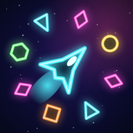

# Звёздный рой

Космический рогалик для Android и браузера в духе Vampire Survivors. Корабль летит туда, куда ведёшь пальцем, оружие стреляет само. Задача — продержаться 10 минут против растущего роя, собрать билд из оружия и модулей, эволюционировать его и уничтожить флагман роя.



## Что внутри

- **10 видов оружия**: бластер, самонаводящиеся ракеты, боевые дроны, импульс, цепная молния, плазменное поле, пила-бумеранг, мины, лазер, сингулярность. У каждого 5 уровней.
- **10 эволюций.** Оружие 5-го уровня вместе с нужным модулем превращается в новое из контейнера элитного врага или босса: Гатлинг-шторм, Рой ракет, Кольцо Сатурна, Сверхновая, Гроза, Корона, Вихрь клинков, Кассета, Луч смерти, Горизонт событий. Рецепты видны в карточках улучшений и в Архиве.
- **12 модулей**: урон, перезарядка, площадь, скорость снарядов, мультиствол, двигатель, корпус, броня, нанороботы, магнит, прицел, обучение.
- **Рой из 8 типов врагов**: мошки, дроны, жуки, тараны с рывком, плевуны, крепости, делители и телепортирующиеся призраки. Плюс золотые элитные враги с контейнерами, события «Окружение» и «Стая», контейнеры с монетами, ремкомплектом, магнитом и бомбой.
- **3 босса** со своими паттернами пуль: Матка роя (5:00), Дредноут и Пожиратель звёзд (10:00, флагман сектора).
- **3 сектора** с растущей сложностью: Пояс Ориона, Ледяная туманность, Горизонт событий. Следующий открывается после победы над флагманом.
- **Бесконечный режим** после победы: рой усиливается, боссы приходят каждые две с половиной минуты.
- **Прогресс между полётами**: кредиты за врагов, время, монеты и боссов. 5 кораблей в ангаре, 11 постоянных улучшений в Мастерской, оружие, которое открывается за достижения.
- Синтезированные звуки и генеративная музыка, которая ускоряется на боссах. Вибрация, сохранения, настройки графики для слабых телефонов.
- Бонус: мини-игра «Орбита» (кнопка «Мини-игра» в меню).

## Управление

- **Телефон**: веди пальцем в любом месте экрана — появится джойстик. Отпусти — корабль остановится.
- **Компьютер**: WASD или стрелки, Esc — пауза, 1–3 — выбор улучшения.

## Установка на Android

Каждый пуш в `web/` или `android/` собирает APK через GitHub Actions (`.github/workflows/android.yml`) и выкладывает его в **Releases** репозитория как `zvezdny-roy-1.N.apk`.

1. Открой страницу Releases с телефона и скачай последний `.apk`.
2. Открой файл и разреши установку из этого источника.

Новые версии ставятся поверх старой: APK всегда подписан одним и тем же отладочным ключом (`android/app/debug.keystore`). Это ключ для домашнего проекта, а не для публикации в магазине.

## Запуск в браузере

Игра работает без сборки, это обычные HTML и JS:

```sh
cd web && python3 -m http.server 8000
```

и открыть `http://localhost:8000`. Если раздавать папку `web/` по HTTPS (например, через GitHub Pages), игру можно установить на домашний экран как приложение: есть манифест и офлайн-кэш (`sw.js`).

## Структура

```
web/index.html     экраны и стили
web/js/core.js     утилиты, сохранения, джойстик, пространственная сетка
web/js/data.js     оружие, модули, враги, боссы, корабли, секторы, мастерская
web/js/audio.js    звуковые эффекты и генеративная музыка (WebAudio)
web/js/art.js      процедурные неоновые спрайты и иконки
web/js/game.js     симуляция: оружие, ИИ роя, боссы, волны, награды
web/js/draw.js     отрисовка на Canvas 2D
web/js/ui.js       меню, HUD, окна улучшений и результатов
web/js/main.js     запуск и игровой цикл
web/orbita.html    мини-игра «Орбита»
android/           WebView-обёртка на Java без зависимостей; ассеты берутся из web/
```

Локальная сборка APK (нужен Android SDK): `cd android && ./gradlew assembleDebug`.
