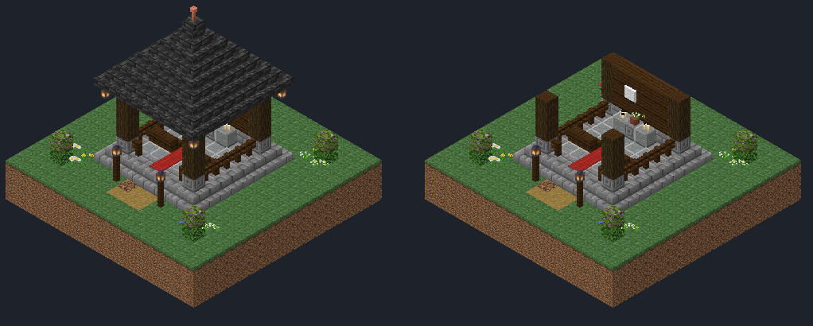
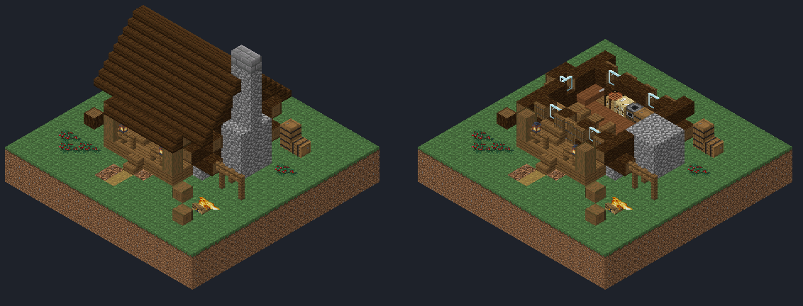
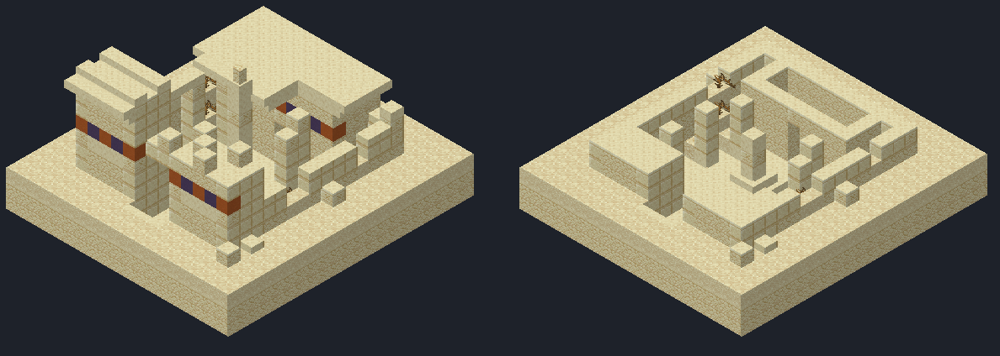
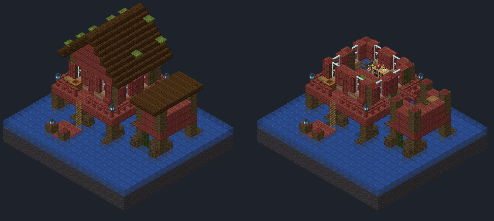
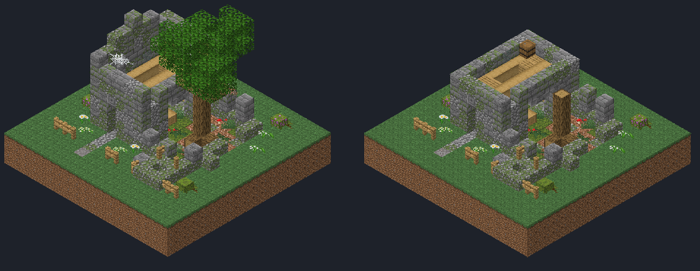
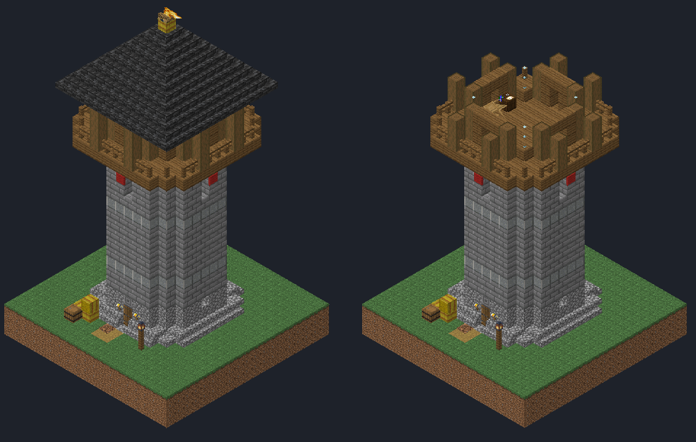
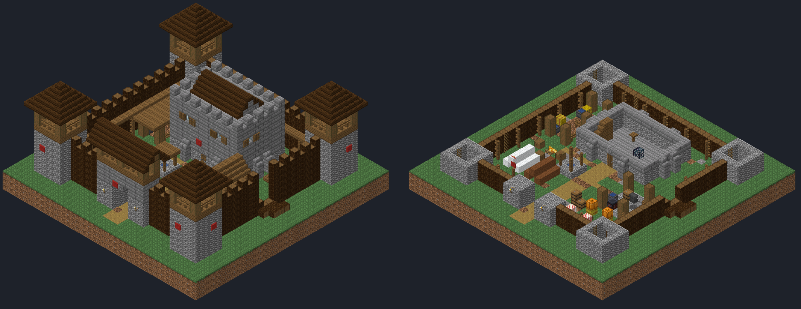
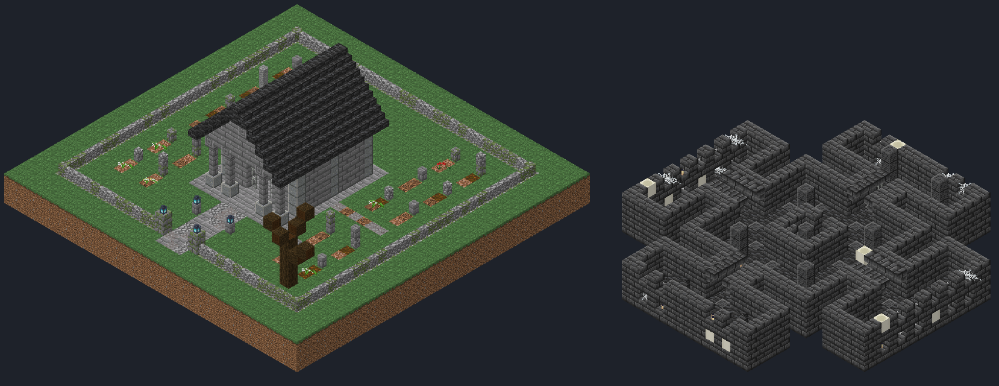

# CCMC Structures — датапак для Minecraft 1.20.1

8 новых построек в ванильном стиле: 5 маленьких и 3 большие. Внутри сундуки
со своими таблицами лута, а в больших постройках ещё и спавнеры мобов.
Постройки генерируются в обычном мире рядом с ванильными, в подходящих биомах.

**Версия:** Minecraft 1.20 / 1.20.1 (`pack_format` 15). Работает в одиночной
игре, на ванильном сервере, а также на Forge/Fabric.

## Установка

1. Скачайте [`dist/CCMC-Structures-1.20.1.zip`](dist/CCMC-Structures-1.20.1.zip).
2. **Новый мир:** при создании мира нажмите «Наборы данных» и перетащите zip
   в окно. **Существующий мир:** положите zip в папку
   `saves/<мир>/datapacks/` (на сервере: `world/datapacks/`) и выполните
   `/reload` или перезапустите мир.
3. Постройки появляются только в **новых, ещё не сгенерированных чанках**.

Быстро найти или поставить постройку:

```
/locate structure ccmc:watchtower
/place structure ccmc:crypt
```

## Постройки

### Маленькие (встречаются часто)

| Постройка | ID | Биомы | Что это |
|---|---|---|---|
| Придорожное святилище | `ccmc:wayside_shrine` | равнины, луга, леса, вишнёвая роща | беседка из тёмного дуба на ступенчатом каменном постаменте, крыша из сланцевой черепицы с медным шпилем, колокол, алтарь со свечами, скамьи, клумбы с кустами азалии, фонари у входа; сундук с подношениями |
| Хижина охотника | `ccmc:hunter_cabin` | тайга, заснеженные равнины, роща | бревенчатый сруб с выступающими углами брёвен, каменная труба с камином, крыльцо со скамьёй, ставни на окнах, открытая мансарда с балками; поленница, костёр, сушилка, ягодные кусты |
| Руины в пустыне | `ccmc:desert_ruin` | пустыня | полузасыпанный двор храма: пилоны ворот с терракотовым поясом, обелиск на мозаике, колоннады, святилище с портиком, декоративные горшки, **подозрительный песок** для археологии |
| Хижина на сваях | `ccmc:swamp_hut` | болото, мангровое болото | дом из мангрового дерева и глиняного кирпича на сваях с корнями, замшелая крутая крыша, ставни, мастерская ведьмы (котёл, варочная стойка, резные книжные полки), мостик к сараю, причал, фонари душ |
| Заросшие руины | `ccmc:overgrown_ruin` | леса, тёмный лес, джунгли | развалины двухэтажной усадьбы, сквозь обрушенное крыло которой пророс старый дуб; плющ, мох, светящийся лишайник, заброшенный сад с колодцем |

### Большие (встречаются редко, как деревни)

| Постройка | ID | Биомы | Что это |
|---|---|---|---|
| Сторожевая башня | `ccmc:watchtower` | равнины, луга, саванна, лес, тайга, холмы | восьмигранная каменная башня высотой 31 блок с деревянной смотровой, обходной галереей и знамёнами. На вершине горит **сигнальный костёр**, дым видно издалека. На 2-м этаже в темноте **спавнер скелетов**, на 3-м казарма, наверху смотровая с главным сундуком. В сундуке может лежать **карта к древнему склепу** |
| Заброшенный форт | `ccmc:abandoned_fort` | равнины, саванна, тайга, заснеженные равнины, луга | частокол 33×33 с боевым ходом и проломом, 4 угловые башни, крытая надвратная башня с решёткой, цитадель с контрфорсами и крышей за зубцами. На первом этаже цитадели **спавнер зомби**, в северо-восточной башне **спавнер скелетов**. Ещё конюшня, кузница, тренировочная площадка с чучелами, палатки, колодец |
| Древний склеп | `ccmc:crypt` | равнины, леса, тёмный лес, тайга, луга | мавзолей с колоннадой посреди огороженного кладбища. **Винтовая лестница** ведёт вниз, в катакомбы из глубинного сланца: зал вокруг лестницы, сводчатые коридоры, 4 крыла с погребальными нишами, сокровищница за решёткой, саркофаги, **спавнеры зомби и скелетов** |

Превью (слева общий вид, справа разрез):

| | |
|---|---|
| Святилище  | Хижина охотника  |
| Руины в пустыне  | Хижина на сваях  |
| Заросшие руины  | Сторожевая башня  |
| Заброшенный форт  | Древний склеп (справа катакомбы)  |

## Особенности

- **Разные экземпляры не одинаковы:** при генерации часть камня случайно
  становится замшелой или потрескавшейся, а у руин выпадают отдельные блоки.
- **Не мешают деревням:** у построек есть зона отчуждения вокруг деревень.
- **Достижения:** отдельная вкладка «Новые постройки», по одному достижению
  на каждую постройку и испытание «Великий исследователь» (найти все 8,
  награда 100 опыта).
- Комнаты со спавнерами полностью тёмные (это проверено), так что спавнеры
  работают как в ванильных данжах.

## Частота появления

Расстояние между попытками генерации (в чанках; у ванильной деревни 34):

| Набор | Шаг сетки | Минимальное расстояние |
|---|---|---|
| Маленькие постройки (общий набор, выбирается подходящая по биому) | 18 | 6 |
| Сторожевые башни | 34 | 12 |
| Заброшенные форты | 46 | 16 |
| Древние склепы | 40 | 14 |

Чтобы изменить частоту, поправьте `spacing`/`separation` в
`data/ccmc/worldgen/structure_set/*.json` (или в `tools/datapack.py`, затем
пересоберите пак).

## Сборка из исходников

Постройки описаны кодом на Python (без внешних зависимостей), а не собраны
вручную в игре:

```
python3 -m tools.build      # собирает datapack/ и dist/*.zip
python3 -m tools.validate   # сверяет пак с данными ванильной 1.20.1
python3 -m tools.preview    # рендерит превью с текстурами в previews/ (нужен Pillow)
```

- `tools/structures.py` — блоки каждой постройки;
- `tools/datapack.py` — генерация, биомы, лут, достижения;
- `tools/validate.py` — проверяет каждый блок и его свойства, предметы, зелья,
  мобов, биомы и ссылки между файлами по официальным данным 1.20.1 (через
  зеркало [misode/mcmeta](https://github.com/misode/mcmeta)). Также проверяет,
  что лестницы, фонари, двери и кровати стоят корректно и что вокруг
  спавнеров нет света.
